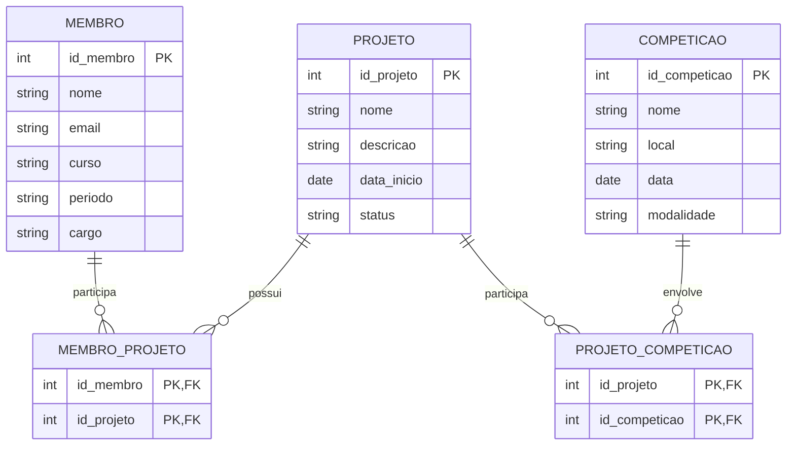

# Sprint 1 - Radar de Dados

## 1. Cenário escolhido

O cenário escolhido é um **Sistema de Gerenciamento da Liga Acadêmica de Robótica e Automação (LARA)**.

O sistema tem como objetivo organizar informações sobre os membros da liga, os projetos desenvolvidos e as competições das quais a equipe participa.

---

## 2. Requisitos do sistema

O sistema deverá permitir:

- Cadastrar membros da LARA;
- Armazenar informações dos projetos;
- Cadastrar competições de robótica;
- Identificar quais membros participam de cada projeto;
- Registrar as competições das quais a equipe participa;
- Organizar as informações de forma estruturada.

---

## 3. Entidades

Foram identificadas as seguintes entidades principais:

### 3.1 Membro

Representa uma pessoa integrante da LARA.

**Atributos:**

| Atributo | Descrição | Chave |
|---|---|---|
| id_membro | Identificador único do membro | PK |
| nome | Nome completo | - |
| email | E-mail do membro | - |
| curso | Curso do membro | - |
| periodo | Período acadêmico | - |
| cargo | Função exercida na LARA | - |

### 3.2 Projeto

Representa um projeto desenvolvido pela LARA.

**Atributos:**

| Atributo | Descrição | Chave |
|---|---|---|
| id_projeto | Identificador único do projeto | PK |
| nome | Nome do projeto | - |
| descricao | Descrição do projeto | - |
| data_inicio | Data de início | - |
| status | Situação atual do projeto | - |

### 3.3 Competição

Representa uma competição de robótica.

**Atributos:**

| Atributo | Descrição | Chave |
|---|---|---|
| id_competicao | Identificador único da competição | PK |
| nome | Nome da competição | - |
| local | Local onde ocorreu | - |
| data | Data da competição | - |
| modalidade | Modalidade disputada | - |

---

## 4. Chaves primárias

Cada entidade possui uma chave primária (PK), utilizada para identificar exclusivamente cada registro:

- **Membro:** `id_membro`
- **Projeto:** `id_projeto`
- **Competição:** `id_competicao`

---

## 5. Relacionamentos

### Membro e Projeto

Um membro pode participar de vários projetos e um projeto pode possuir vários membros.

**Cardinalidade: N:N**

Para representar esse relacionamento em um banco de dados, pode ser utilizada uma entidade associativa chamada `membro_projeto`.

```text
MEMBRO 1 ---- N MEMBRO_PROJETO N ---- 1 PROJETO
```

### Competição e Projeto

Um projeto pode ser utilizado ou apresentado em diferentes competições, e uma competição pode envolver diferentes projetos.

**Cardinalidade: N:N**

Pode ser criada uma entidade associativa chamada `projeto_competicao`.

```text
PROJETO 1 ---- N PROJETO_COMPETICAO N ---- 1 COMPETICAO
```

---

## 6. Modelo Entidade-Relacionamento



---

## 7. Conclusão

A modelagem proposta organiza as principais informações necessárias para um sistema de gerenciamento da LARA. A separação em entidades permite estruturar os dados de maneira organizada, enquanto as chaves primárias e os relacionamentos definem como as informações serão identificadas e conectadas.

Este modelo pode posteriormente servir como base para a criação de um banco de dados real e para o desenvolvimento de uma aplicação de gerenciamento da LARA.

(pode haver alguns erros)